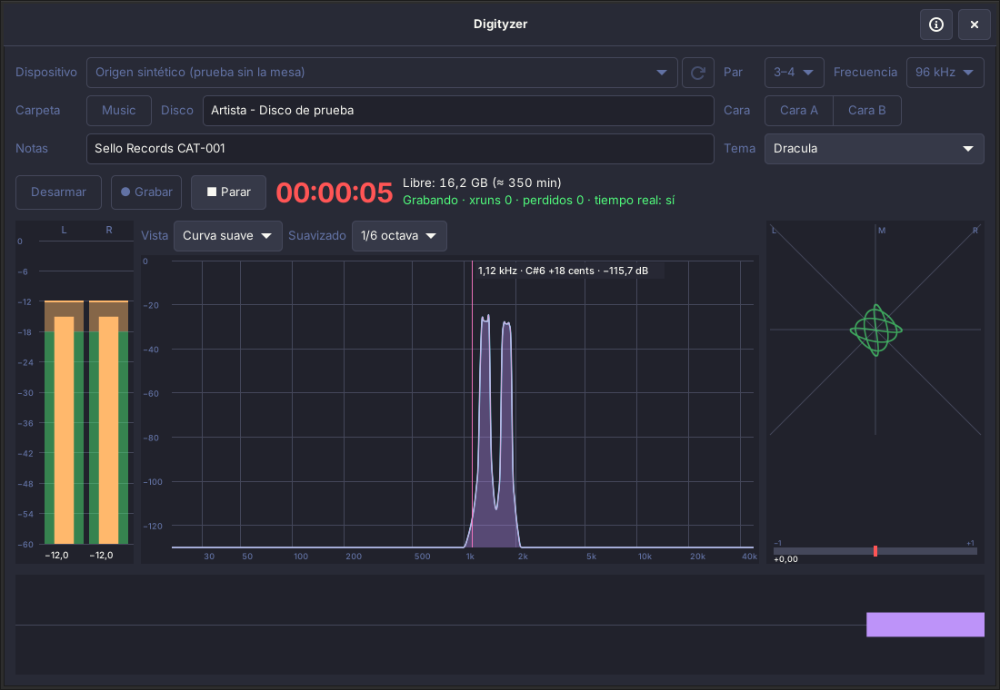

<p align="center">
  
</p>

<h1 align="center">Digityzer</h1>

<p align="center">
  Digitalizador de vinilo <b>bit-perfect</b> para Linux, en Rust + GTK4.<br>
  Graba desde la Allen &amp; Heath Xone:96 por ALSA, mide la captura mientras suena y guarda un
  master que nunca se modifica.
</p>

<p align="center">
  <b>Director del proyecto:</b> David Gimenez · <b>Programación:</b> Claude (Anthropic)
</p>



## Qué hace

- **Graba sin tocar la señal**: dispositivo `hw:` en exclusiva, formato nativo de la tarjeta y
  frecuencia exacta. Sin `plughw`, sin remuestreo, sin PipeWire, PulseAudio ni JACK.
- **Nunca pierde ni sobrescribe**: el hilo de captura tiene prioridad de tiempo real y no se
  bloquea; los cortes de ALSA (xruns) se anotan con su instante; el master y su ficha quedan en
  solo lectura.
- **Mide mientras graba**: medidores de pico y RMS con aviso de clipping, espectro en curva suave
  (con nota musical bajo el cursor), barras o cascada, goniómetro con correlación de fase y forma
  de onda.
- **Comprueba**: cada master lleva una huella blake3 por bloques; `verify` dice si ha cambiado un
  solo bit.
- **Se adapta a tu escritorio**: diez temas de color (Dracula, Catppuccin, Gruvbox, Nord, Tokyo
  Night, Rosé Pine, Everforest, Kanagawa, Monokai Pro y Ayu) que cambian en caliente.

## Descargar y usar

Descarga el AppImage de [Releases](https://github.com/NoctaBremen/Digityzer/releases):

```bash
chmod +x Digityzer-v1.0.0-x86_64.AppImage
./Digityzer-v1.0.0-x86_64.AppImage                 # interfaz
./Digityzer-v1.0.0-x86_64.AppImage cli probe       # tarjetas y formatos
```

Arma, graba y para: el **[manual de uso](docs/MANUAL.md)** lo explica todo paso a paso,
incluida la cadena de señal de la Xone:96, los archivos que se generan y la solución de
problemas.

Para que el hilo de captura tenga prioridad de tiempo real en Arch:

```bash
sudo pacman -S realtime-privileges && sudo usermod -aG realtime "$USER"
```

## Documentación

| Documento | Para qué |
|---|---|
| [Manual de uso](docs/MANUAL.md) | Instalar, grabar, leer las gráficas, archivos, CLI y problemas |
| [Arquitectura](docs/ARQUITECTURA.md) | Hilos, crates, formatos y decisiones técnicas |
| [Pruebas con la mesa](docs/PRUEBAS_HARDWARE.md) | Comprobaciones que necesitan la Xone:96 |
| [Cambios](CHANGELOG.md) | Qué trae cada versión |
| [CLAUDE.md](CLAUDE.md) | Convenciones para contribuir |

## Compilar

```bash
sudo pacman -S --needed rust gtk4 alsa-lib pkgconf      # Ubuntu: libgtk-4-dev libasound2-dev
cargo build --release
./target/release/digityzer
```

Comprobaciones (las mismas que el CI):

```bash
cargo fmt --all
cargo clippy --workspace --all-targets --all-features -- -D warnings
cargo test --workspace --all-features
```

AppImage: `packaging/appimage/build-appimage.sh` → `dist/`. Al crear una etiqueta `v*`, el
workflow de release lo construye y lo publica.

## Estructura

| Crate | Responsabilidad |
|---|---|
| `crates/audio-core` | Código compartido con Spector y temas de color |
| `crates/digityzer-audio` | Captura ALSA, escritor del master, sesión y verificación |
| `crates/digityzer-dsp` | Medidores, espectro, correlación, goniómetro y forma de onda |
| `crates/digityzer-project` | Ficha JSON del master |
| `crates/digityzer-app` | Binarios `digityzer` (GTK4) y `digityzer-cli` |
| `crates/digityzer-testkit` | Señales sintéticas para los tests |

## Créditos

- **Dirección del proyecto:** David Gimenez
- **Programación:** Claude (Anthropic)
- Código compartido con Spector, el analizador espectral del mismo autor.
- Construido con GTK 4, alsa-lib, RustFFT, rtrb, triple_buffer, blake3 y lofty, entre otros.
- Paletas de color de sus temas respectivos.

## Licencia

[MIT](LICENSE) © 2026 David Gimenez.
