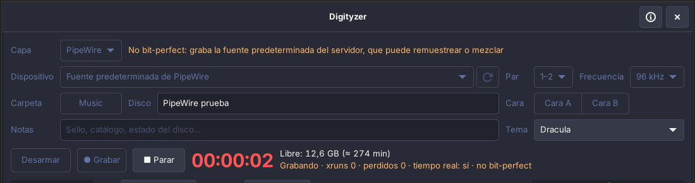
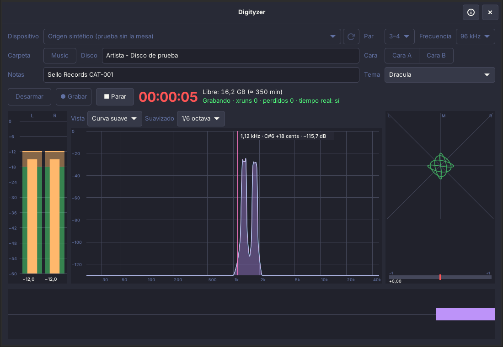
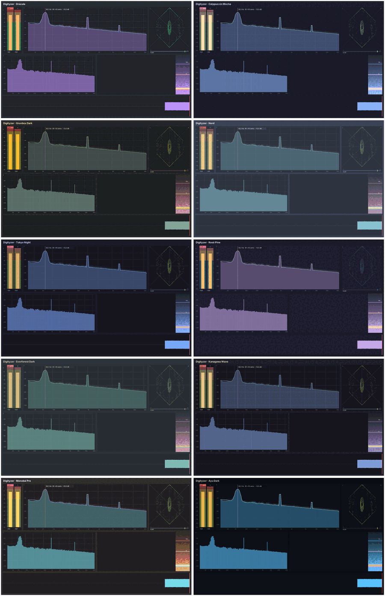
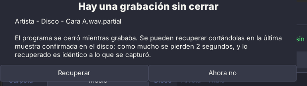

# Manual de uso de Digityzer 1.2

<p align="center"></p>

Digityzer graba tus vinilos desde la Allen & Heath Xone:96 de forma **bit-perfect**: lo que sale
del previo RIAA de la mesa llega al disco duro tal cual, sin remuestrear, sin convertir el
formato y sin pasar por PipeWire, PulseAudio ni JACK. Mientras grabas te enseña niveles,
espectro, fase y forma de onda, y al terminar guarda un **master** que nunca se vuelve a tocar,
con una ficha JSON que dice cómo se grabó y una huella para comprobar más adelante que el archivo
sigue intacto.

**Director del proyecto:** David Gimenez · **Programación:** Claude (Anthropic)

---

## Índice

1. [Requisitos](#1-requisitos)
2. [Instalación](#2-instalación)
3. [Antes de grabar: la cadena de señal](#3-antes-de-grabar-la-cadena-de-señal)
   - [Capa de audio](#capa-de-audio)
4. [La ventana principal](#4-la-ventana-principal)
5. [Grabar una cara paso a paso](#5-grabar-una-cara-paso-a-paso)
6. [Medidores de nivel](#6-medidores-de-nivel)
7. [Espectro](#7-espectro)
8. [Goniómetro y correlación de fase](#8-goniómetro-y-correlación-de-fase)
9. [Forma de onda](#9-forma-de-onda)
10. [Temas de color](#10-temas-de-color)
11. [Los archivos que se generan](#11-los-archivos-que-se-generan)
12. [Comprobar un master](#12-comprobar-un-master)
    - [Si el programa se cierra grabando](#si-el-programa-se-cierra-grabando)
13. [Línea de órdenes](#13-línea-de-órdenes)
14. [Configuración](#14-configuración)
15. [Solución de problemas](#15-solución-de-problemas)
16. [Glosario](#16-glosario)

---

## 1. Requisitos

| Qué | Detalle |
|---|---|
| Sistema | Linux x86_64. Pensado para Arch Linux con Hyprland (Wayland) y kernel PREEMPT_RT |
| Audio | ALSA (`alsa-lib`). Opcionalmente PipeWire (`pipewire-alsa`) o PulseAudio (`pulseaudio-alsa`) |
| Tarjeta | Allen & Heath Xone:96 por USB (class compliant). Cualquier tarjeta ALSA con `hw:` sirve |
| Espacio | Unos 2,8 GB por hora a 96 kHz en 32 bits (el programa te dice los minutos que caben) |
| Tiempo real | Recomendado: paquete `realtime-privileges` y tu usuario en el grupo `realtime` |

## 2. Instalación

### AppImage (recomendado)

1. Descarga `Digityzer-v1.2.0-x86_64.AppImage` y su `.sha256` de la página de
   [releases](https://github.com/NoctaBremen/Digityzer/releases).
2. Comprueba la descarga y dale permiso de ejecución:

   ```bash
   sha256sum -c Digityzer-v1.2.0-x86_64.AppImage.sha256
   chmod +x Digityzer-v1.2.0-x86_64.AppImage
   ```

3. Ábrelo con doble clic o desde la terminal:

   ```bash
   ./Digityzer-v1.2.0-x86_64.AppImage
   ```

El AppImage lleva GTK 4 dentro; ALSA (`libasound`) se usa siempre la del sistema, con tu
configuración. El mismo archivo sirve para la línea de órdenes: `./Digityzer-…AppImage cli …`
(ver [sección 13](#13-línea-de-órdenes)).

### Prioridad de tiempo real

El hilo que lee de la tarjeta intenta ponerse en `SCHED_FIFO`. Para que el sistema se lo permita:

```bash
sudo pacman -S realtime-privileges
sudo usermod -aG realtime "$USER"
```

Cierra la sesión y vuelve a entrar. Sin esto Digityzer graba igual, pero avisa de que no tiene
tiempo real y el riesgo de cortes (xruns) es mayor si el equipo va cargado.

### Compilar desde el código

```bash
sudo pacman -S --needed rust gtk4 alsa-lib pkgconf
git clone https://github.com/NoctaBremen/Digityzer
cd Digityzer
cargo build --release
./target/release/digityzer
```

## 3. Antes de grabar: la cadena de señal

Digityzer toma la señal **a la salida del previo RIAA** de la Xone:96, por USB, sin pasar por la
ganancia, la EQ, el fader ni los filtros de la mesa (comprobado: mover la EQ o la ganancia no
cambia el envío USB).

1. **Plato** (Technics SL-1200 MK2): pitch a 0 (quartz lock), fuerza de apoyo, antiskating y VTA
   ajustados para tu cápsula.
2. **Cápsula** (Grado DJ200i): carga estándar de 47 kΩ.
3. **Mesa**: el plato en la entrada PHONO de un canal (1–4) y el conmutador USB de ese canal en
   PHONO.
4. **USB 1** de la Xone hacia el ordenador.

Mapa USB de la Xone:96 hacia el ordenador:

| Par USB | Origen |
|---|---|
| 1–2 | Canal 1 |
| 3–4 | Canal 2 (hoy, plato A) |
| 5–6 | Canal 3 (hoy, plato B) |
| 7–8 | Canal 4 |
| 9–10 | SEND 1 (no usar: puede llevar EQ) |
| 11–12 | SEND 2 o master (no usar) |

### Capa de audio

La primera fila de la ventana, **Capa**, decide por dónde se graba:



| Capa | Qué graba | Bit-perfect | Necesita |
|---|---|---|---|
| **ALSA directo** (por defecto) | El `hw:` elegido, en exclusiva, con todos sus canales y su formato nativo | **Sí** | `alsa-lib` |
| **PipeWire** | La fuente predeterminada de PipeWire, en estéreo | No | `pipewire` y `pipewire-alsa`, con PipeWire en marcha |
| **PulseAudio** | La fuente predeterminada de PulseAudio (o de pipewire-pulse), en estéreo | No | `pulseaudio-alsa` (alsa-plugins) y el servidor en marcha |
| **Predeterminado de ALSA** | Lo que diga tu configuración de ALSA para `default` | No | Un `default` configurado |

- Para un master de archivo, usa **ALSA directo**: es la única capa en la que lo guardado es
  idéntico a lo que entrega la tarjeta.
- Las otras sirven cuando la tarjeta la tiene ocupada un servidor de sonido o para grabar otra
  fuente. El servidor puede remuestrear, mezclar o aplicar volumen. Por eso Digityzer lo avisa en
  ámbar («No bit-perfect») al elegirla, al armar y mientras graba, y la ficha JSON del master
  lleva `"bit_perfect": false` y la capa usada.
- En PipeWire y PulseAudio la fuente es la **predeterminada del servidor**: elígela antes con
  `wpctl set-default`, `pavucontrol` o el panel de sonido. El par es siempre 1–2.
- Si una capa no está instalada o el servidor no está en marcha, el dispositivo lo dice («no
  disponible — hace falta …»). `cli probe` también lo lista.

> **xwax y Digityzer no pueden usar USB 1 a la vez.** ALSA da el dispositivo `hw:` en exclusiva.
> Cierra xwax antes de grabar por USB 1, o graba por USB 2 si la mesa lo permite. Si está
> ocupado, Digityzer te lo dice (ver [Dispositivo ocupado](#dispositivo-ocupado)).

## 4. La ventana principal



De arriba abajo:

| Zona | Qué hay |
|---|---|
| Barra de título | **ⓘ Acerca de** (versión y créditos) y **✕ Cerrar** |
| Capa | ALSA directo (bit-perfect), PipeWire, PulseAudio o Predeterminado de ALSA, con su aviso ([ver](#capa-de-audio)) |
| Dispositivo | La tarjeta y su dispositivo `hw:`. El botón ↻ vuelve a buscar tarjetas. «Origen sintético» sirve para probar el programa sin la mesa |
| Par | El par de canales a grabar, numerado como en la mesa (3–4 = plato A) |
| Frecuencia | 44,1, 48 o 96 kHz, solo las que la tarjeta admite de forma nativa |
| Carpeta y Disco | Dónde se guarda y con qué nombre: `<Disco> - Cara A.wav` |
| Cara | A o B; al terminar la cara A pasa sola a la B |
| Notas | Sello, catálogo, estado del disco… se guardan en la ficha JSON |
| Tema | El tema de color de toda la ventana |
| Armar · Grabar · Parar | Los tres pasos de una grabación |
| Cronómetro | Tiempo de la grabación en curso (en rojo mientras graba) |
| Libre | Espacio libre en la carpeta y minutos que caben al formato actual |
| Estado | Qué está pasando; mientras grabas, en verde si no hay cortes y en rojo si los hay |
| Medidores, espectro, goniómetro | Ver secciones 6 a 8 |
| Forma de onda | Los últimos 60 segundos (sección 9) |

**Cerrar** (✕) es seguro en cualquier momento: si estás grabando, el master y su ficha se cierran
bien antes de salir.

## 5. Grabar una cara paso a paso

1. **Dispositivo**: elige la Xone:96 (USB 1). **Par**: 3–4 para el plato A. **Frecuencia**: 96 kHz.
2. **Carpeta**: pulsa el botón y elige dónde guardar. **Disco**: por ejemplo «Artista - Título».
   **Notas** si quieres. **Cara**: A.
3. Pulsa **Armar**. Digityzer abre la tarjeta y empieza a medir **sin grabar nada**: pon el disco y
   mira los medidores, el espectro y la fase. La línea de estado dice formato, frecuencia y
   canales abiertos.
4. Pulsa **● Grabar** al bajar la aguja. El cronómetro se pone en rojo.
5. Pulsa **■ Parar** cuando acabe la cara. Se cierra el master, se escribe su ficha y la ventana
   pasa a **Cara B**. La línea de estado dice el archivo guardado, la duración y si hubo cortes.
6. Da la vuelta al disco y vuelve a pulsar **Grabar**: no hace falta desarmar.
7. **Desarmar** suelta la tarjeta (por ejemplo, para abrir xwax).

Si al parar hubo cortes (xruns) o se perdieron datos, aparece un aviso con el número y la ficha
JSON tiene el instante exacto de cada uno.

## 6. Medidores de nivel

Dos barras, L y R, en dBFS (0 = fondo de escala digital), de −60 a 0:

- **Barra ancha translúcida**: el pico del último instante.
- **Barra estrecha sólida**: el nivel RMS de los últimos 300 ms (un seno a fondo de escala marca
  −3 dBFS de RMS).
- **Línea**: el pico retenido durante 2 s; su valor aparece debajo de cada barra.
- **Colores**: verde hasta −18 dBFS, ámbar de −18 a −3 y rojo por encima de −3.
- **CLIP**: se enciende en rojo arriba si hay **tres o más muestras seguidas** en el fondo de
  escala. Se queda encendido hasta que vuelves a armar o empiezas otra grabación.

El envío USB de PHONO de la Xone no tiene ajuste de nivel: si una cápsula muy caliente marca CLIP,
el remedio está en la cadena (otra cápsula o ganancia previa), no en Digityzer.

## 7. Espectro

Encima del espectro eliges **Vista** y, para la curva, **Suavizado**.

### Curva suave (por defecto)

Tres capas a la vez:

| Capa | Cómo se ve | Qué es |
|---|---|---|
| Instantánea | Curva con relleno translúcido | El espectro de ahora mismo (ligeramente promediado) |
| Media | Línea de 1,5 px | Media de los últimos 1,5 s: la «forma» estable del sonido |
| Picos | Línea fina | El máximo reciente de cada frecuencia, que cae 6 dB por segundo |

- **Suavizado**: 1/3, 1/6 o 1/12 de octava. 1/3 da una curva tranquila para ver el balance
  tonal; 1/12 separa notas y zumbidos.
- **Cursor**: pasa el ratón por encima y verás la frecuencia, la **nota musical con su desviación
  en cents** (La4 = 440 Hz) y el nivel de la capa media. Ejemplo: «62,1 Hz · B1 +10 cents ·
  −13,5 dB».
- La resolución en graves es de unos 5,9 Hz por punto a 96 kHz, así que los graves se dibujan
  como una curva continua, sin escalones.

### Barras

160 barras en escala logarítmica de 20 Hz a la mitad de la frecuencia de muestreo. Cada barra
muestra el máximo de su banda, así que un tono no se diluye.

### Cascada

Espectrograma en vivo: el tiempo corre de izquierda a derecha (lo más reciente a la derecha,
unos 50 s de historia) y la frecuencia sube de abajo arriba, con marcas en 100 Hz, 1 kHz y 10 kHz.
Los colores van del fondo de la gráfica (silencio, por debajo de −90 dBFS) a los colores claros
del tema (niveles fuertes, −10 dBFS). Es útil para ver zumbidos constantes, cortes de frecuencia y
clics.

Cambiar de vista mientras grabas no afecta a la grabación.

## 8. Goniómetro y correlación de fase

- **Goniómetro**: cada punto es una pareja de muestras L/R. Arriba y abajo es el «medio»
  (L + R), a los lados el «lado» (L − R).
  - Mono perfecto: una línea vertical.
  - Estéreo normal: una nube más alta que ancha.
  - Un canal con la fase invertida: una línea horizontal.
- **Correlación** (barra de −1 a +1 debajo): +1 = mono, 0 = canales independientes,
  −1 = fase invertida. Verde por encima de 0,3, ámbar entre 0 y 0,3, rojo por debajo de 0. En un
  vinilo, una correlación negativa sostenida suele indicar un cable o una cápsula con la fase
  cambiada.

## 9. Forma de onda

Los últimos 60 segundos de la mezcla del par, desplazándose hacia la izquierda; en el color de la
curva mientras grabas. Las columnas que tocan el fondo de escala se pintan en rojo.

## 10. Temas de color

Diez temas oscuros, con sus paletas oficiales: **Dracula** (por defecto), Catppuccin Mocha,
Gruvbox Dark, Nord, Tokyo Night, Rosé Pine, Everforest Dark, Kanagawa Wave, Monokai Pro y Ayu
Dark. Se eligen en **Tema**; el cambio es inmediato (también grabando) y se recuerda al volver a
abrir.



Todas las gráficas y los controles usan los mismos papeles de color: fondo, gráfica, rejilla,
texto, tenue, curva, media, picos, ok, aviso y clip. Si un tema no llega al contraste mínimo de
lectura (texto 4,5:1, texto secundario 3:1), se aclara solo ese color; hoy pasa en el texto
secundario de Nord, Tokyo Night y Ayu.

Para ver todas las gráficas en todos los temas de una vez:

```bash
./Digityzer-v1.2.0-x86_64.AppImage render-themes capturas/
```

Genera un PNG por tema en `capturas/` con una señal de prueba.

## 11. Los archivos que se generan

Por cada cara, dos archivos en la carpeta elegida:

```
Artista - Título - Cara A.wav        ← el master
Artista - Título - Cara A.wav.json   ← su ficha
```

Si ya existen, se añade ` (2)`, ` (3)`…: **nunca se sobrescribe nada**.

### El master

- **WAV** con el par elegido y el **formato nativo** de la tarjeta (`S32_LE`, `S24_3LE` o
  `S16_LE`), byte a byte como llegó. Por encima de 4 GiB pasa a **RF64** (el WAV de más de 4 GiB
  que leen Audacity, ffmpeg o Spek).
- La cabecera se actualiza cada segundo: si el ordenador se cae a mitad, el archivo se puede
  abrir hasta casi el final.
- Al cerrarse queda en **solo lectura**. Cortes, limpieza o exportaciones (fases siguientes)
  crean archivos nuevos.

### La ficha JSON

| Campo | Significado |
|---|---|
| `audio_backend` | Capa de audio: `alsa`, `pipewire`, `pulse`, `default` (o `sintetico`) |
| `bit_perfect` | `true` solo con ALSA directo |
| `device`, `card_name` | Dispositivo ALSA (o el PCM del plugin) y nombre de la tarjeta o fuente |
| `sample_rate`, `sample_format`, `container_bits` | Formato tal como llegó |
| `lsb_zero_bits` | Bits bajos que han sido cero en todas las muestras (8 = 24 bits útiles en 32) |
| `channels_opened`, `channel_pair` | Canales abiertos en la tarjeta y par grabado (desde 1) |
| `container` | `WAV` o `RF64` |
| `frames`, `duration_s`, `data_bytes` | Tamaño de la grabación |
| `started_at`, `finished_at` | Inicio y fin, en UTC |
| `realtime` | Si el hilo de captura tuvo prioridad de tiempo real |
| `xruns` | Cada corte de ALSA, con su frame y su segundo |
| `frames_lost_ring` | Frames perdidos porque el disco no daba abasto (debe ser 0) |
| `hash` | Huella blake3 por bloques de 1 MiB y total del audio |
| `notes` | Tus notas y la cara |
| `interrupted`, `interruption` | Si la grabación no terminó con «Parar» y por qué |
| `recovered`, `seconds_lost` | Si se recuperó de un `.partial` y cuánto se perdió (estimación) |

### Mientras se graba: el archivo `.partial`

Durante la grabación el master se llama `… - Cara A.wav.partial` y tiene al lado
`… - Cara A.wav.partial.json`. Cada 2 segundos Digityzer confirma en el disco lo grabado (cabecera
al día y `fdatasync`). Al pulsar **Parar** se renombra a `… - Cara A.wav` y se escribe su ficha.

## 12. Comprobar un master

Para saber si un master sigue idéntico al día en que se grabó:

```bash
./Digityzer-v1.2.0-x86_64.AppImage cli verify "Artista - Título - Cara A.wav"
```

Dice «correcto» o qué bloques (de 1 MiB) han cambiado.

### Si el programa se cierra grabando

Si el ordenador se apaga, el programa se cuelga o se mata a mitad de una cara, queda el
`.partial`. Al volver a abrir Digityzer (o al elegir esa carpeta) aparece este aviso:



**Recuperar** corta la grabación en la última muestra confirmada (como mucho se pierden 2 s), rehace
la cabecera, calcula la huella y la deja como un master normal, con su ficha marcada como
`"recovered": true` y los segundos perdidos en `seconds_lost`. Lo recuperado es idéntico bit a bit
a lo que se capturó hasta ese punto. Si ya existe un master con ese nombre, se guarda como
`… (recuperado).wav`: nunca se sobrescribe nada. Desde la terminal:

```bash
./Digityzer-v1.2.0-x86_64.AppImage cli recover ~/Música
```

### Si la tarjeta se apaga o se desconecta

La grabación se cierra sola con todo lo capturado, la ventana avisa y la ficha del master lleva
`"interrupted": true` y el motivo en `interruption`.

## 13. Línea de órdenes

Con el AppImage, antepón `cli`; si compilaste, usa `digityzer-cli` directamente.

| Orden | Para qué |
|---|---|
| `cli probe` | Lista las tarjetas y, por cada `hw:` de captura, formatos, frecuencias y canales; marca los ocupados |
| `cli record …` | Graba desde la terminal |
| `cli verify <master>` | Comprueba un master contra su ficha |
| `cli recover [carpeta\|archivo]` | Recupera grabaciones cortadas de golpe (`.partial`) |
| `render-themes <carpeta>` | Capturas de referencia de los diez temas |
| `--version` | Versión y créditos |

`record`:

```
digityzer-cli record [OPCIONES] --pair <PAR> <ARCHIVO>

  -b, --backend <CAPA>        alsa (por defecto, bit-perfect), pipewire, pulse o default
  -d, --device <DISPOSITIVO>  hw: de la tarjeta (ver probe), p. ej. hw:CARD=USB1,DEV=0;
                              solo con --backend alsa
  -p, --pair <PAR>            par de canales desde 1: 3-4 (plato A), 5-6 (plato B)
  -r, --rate <HZ>             frecuencia nativa [por defecto: 96000]
  -f, --format <FORMATO>      S32_LE, S24_3LE o S16_LE (por defecto, el mejor que admita)
  -n, --notes <TEXTO>         notas del disco
      --duration <SEGUNDOS>   para sola (si no, Ctrl-C)
      --simulate              origen sintético, para probar sin la mesa
```

Ejemplo:

```bash
./Digityzer-v1.2.0-x86_64.AppImage cli record --device hw:CARD=USB1,DEV=0 --pair 3-4 \
    --notes "Sello, catálogo, cara A" "Disco - Cara A.wav"
```

Por PipeWire (fuente predeterminada, no bit-perfect):

```bash
./Digityzer-v1.2.0-x86_64.AppImage cli record --backend pipewire --pair 1-2 "Prueba.wav"
```

Ctrl-C para parar: lo capturado hasta ese momento se escribe entero antes de cerrar. Si el
dispositivo está ocupado, sale con el código 2.

## 14. Configuración

`~/.config/digityzer/config.toml` (o `$XDG_CONFIG_HOME/digityzer/config.toml`) guarda tema, vista
del espectro y suavizado:

```toml
theme = "dracula"
spectrum_view = "curva"   # curva, barras o cascada
smoothing = 6             # 3, 6 o 12 (fracción de octava)
audio_backend = "alsa"    # alsa, pipewire, pulse o default
```

Si el archivo falta o está mal, se usan esos valores. El nivel de registro se cambia con
`DIGITYZER_LOG` (por ejemplo `DIGITYZER_LOG=debug`).

## 15. Solución de problemas

### Dispositivo ocupado

«XONE 96 USB 1 está en uso por otro programa (¿xwax abierto?)». Otro programa tiene abierta la
tarjeta en exclusiva. Cierra xwax (o lo que la use) y vuelve a armar, o graba por otro USB.

### «La capa PipeWire/PulseAudio no está disponible»

Falta el plugin de ALSA o el servidor no está en marcha. En Arch:
`sudo pacman -S pipewire-alsa` (PipeWire) o `sudo pacman -S pulseaudio-alsa` (PulseAudio), y
comprueba que el servidor corre (`wpctl status` o `pactl info`).

### Sin prioridad de tiempo real

La línea de estado dice «tiempo real: no» o el CLI avisa. Instala `realtime-privileges` y añade
tu usuario al grupo `realtime` ([sección 2](#prioridad-de-tiempo-real)).

### La grabación tiene xruns

El sistema no leyó a tiempo de la tarjeta y se perdieron muestras en esos instantes (anotados en
la ficha). Activa el tiempo real, cierra programas pesados y graba en un disco local.

### No aparece la tarjeta

Pulsa ↻. Comprueba que está conectada con `cli probe`. Si `probe` dice «No hay tarjetas ALSA»,
revisa el cable y que el usuario pueda usar el audio (grupo `audio` en algunas instalaciones).

### «No admite X Hz de forma nativa»

Digityzer nunca remuestrea. Elige una frecuencia que la tarjeta ofrezca (las que muestra
`probe`).

### «La tarjeta solo ofrece S24_LE»

Ese formato no se puede guardar en WAV sin desplazar las muestras, que ya sería convertir.
Digityzer prefiere no grabar a grabar algo que no es bit-perfect.

### La captura se ha detenido

La tarjeta dejó de dar audio (desconectada o error de ALSA). El master queda guardado hasta ese
punto con su ficha.

### Poco espacio

Mira «Libre» antes de grabar: indica los minutos que caben al formato actual.

## 16. Glosario

| Término | Significado |
|---|---|
| Bit-perfect | Las muestras guardadas son idénticas a las que entrega la tarjeta |
| `hw:` | Acceso directo de ALSA a la tarjeta, sin conversiones (al contrario que `plughw:`) |
| Master | La grabación original de una cara, que no se modifica nunca |
| Xrun | Corte por no leer a tiempo de la tarjeta: se pierden muestras en ese instante |
| dBFS | Decibelios respecto al fondo de escala digital (0 dBFS = máximo) |
| RMS | Nivel medio de energía de la señal |
| Correlación | Parecido entre L y R: +1 mono, −1 fase invertida |
| RF64 | Variante de WAV para archivos de más de 4 GiB |
| Huella (hash) | Resumen blake3 del audio: si cambia un solo bit, cambia la huella |

---

Digityzer 1.2 · © 2026 David Gimenez · Licencia MIT ·
[github.com/NoctaBremen/Digityzer](https://github.com/NoctaBremen/Digityzer)
